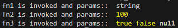

One of the pattern to dynamically invoke functions based on the specific identifier.

### Function List

Each function (`fn1`, `fn2` or `fn3`) accepts different parameters.

```javascript
const fn1 = (args) => {
    const { key1 } = args;
    console.log('fn1 is invoked and params:: ', key1)
}
const fn2 = (args) => {
    const { key2 } = args;
    console.log('fn2 is invoked and params:: ', key2)
}
const fn3 = (args) => {
    const { key3, key4, key5 } = args;
    console.log('fn3 is invoked and params:: ', key3, key4, key5)
}
```

### Mapping

Mapping to associated function (`fn1`, `fn2` or `fn3`) using switch case with `type` as identifier along with the parameters.

```javascript
const mapToFunctions = ({ type, ...params }) => {
    switch (type) {
        case '1':
            return { f: fn1, args: params }
        case '2':
            return { f: fn2, args: params }
        case '3':
            return { f: fn3, args: params }
        default:
            break;
    }
}
```

### Testing with sample params

```javascript
const params1 = {
    'key1': 'string'
}
const receivedFnA = mapToFunctions({ type: '1', ...params1 });
receivedFnA.f(receivedFnA.args)

const params2 = {
    'key2': 100
}
const receivedFnB = mapToFunctions({ type: '2', ...params2 });
receivedFnB.f(receivedFnB.args)

const params3 = {
    'key3': true,
    'key4' : false,
    'key5': null
}
const receivedFnC = mapToFunctions({ type: '3', ...params3 });
receivedFnC.f(receivedFnC.args)
```

### Output



### Use Cases

This pattern can be used,

* In handling different events by invoking its associated event handlers.
    
* When dealing with different API responses to apply different logic based on the response type.
    

Allows flexibility in adding new types and mapping them to new functions without modifying the existing logic.

Provides code reusability, more readable and maintainable.
