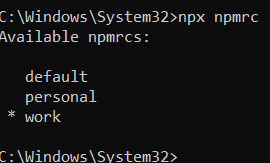

Easy way to achieve it!!!

Our first step is to create **npmrc profiles** for each registry.

Example: Creating 2 profiles `personal` and `work`

```typescript
npx npmrc -c personal
```

```typescript
npx npmrc -c work
```

To view the profiles which are created, use the below command to list them.

```typescript
npx npmrc
```



Next step to set the registry for each profile.

1.  Switch to `personal` profile and set the registry
    
    ```typescript
    npx npmrc personal
    ```
    
    ```typescript
    npm config set registry https://registry.example1.com
    ```
    
2.  Switch to `work` profile and set the registry
    
    ```typescript
    npx npmrc personal
    ```
    
    ```typescript
    npm config set registry https://registry.example2.com
    ```
    

That's it. You can switch between the profiles simply using the below command:

```typescript
npx npmrc <profile_name>
```

**Note:** You can get the registry url which is used in the current profile by using the below command:

```typescript
npm config get registry
```
