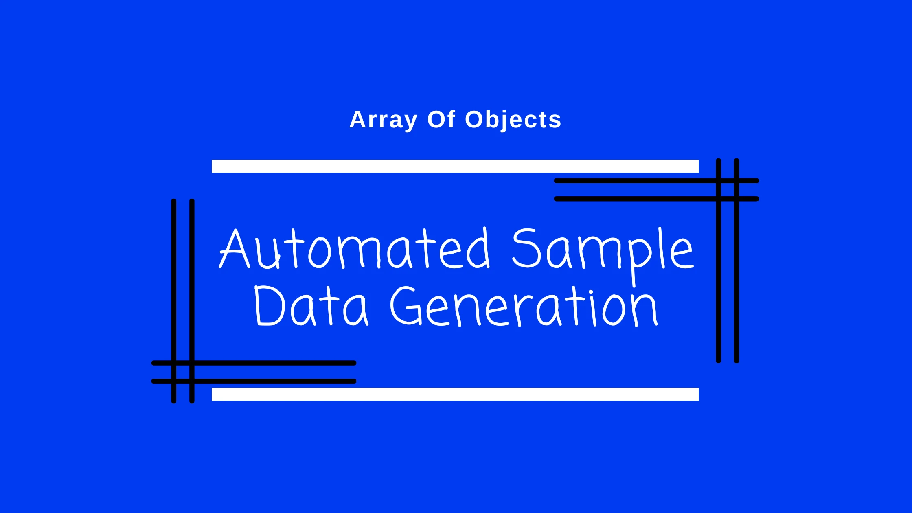

# Generating Customized Sample Data to Use in the Development
## A Guide to Creating Mock Data for Testing


My aim is create an array of objects with some fields and to use in the development process as sample data.

The following fields are required.

```javascript
1. title as String
2. subTitle as String
3. shortDescription as String
4. content as String
5. groupIds as Array of Numbers
6. active as Boolean
7. id as Number
8. category as String
```

*   `title` - just appending `index` to the `Title` as value
    
*   `subTitle` - just appending `index` to the `Sub Title` as value
    
*   `numberOfObj` - number of sample records required to create
    
*   `shortDescription` and `content` - constant string defined
    
*   `groupIds` - array of numbers (array length not more than `5` and values not more than `100`.
    
*   `active` - either `true` or `false`
    
*   `id` - same as index
    
*   `category` - one of the values of `categories` array
    

```javascript
const numberOfObj = 5;

const categories = ['Earth', 'Mars', 'Moon', 'Sun', 'Orion', 'Neptune'];
const shortDescription = 'Lorem ipsum dolor sit amet.'
const content = 'Lorem ipsum dolor sit amet consectetur adipisicing elit.
Totam, aliquid.'

let arrayOfObjects = [];

for (let i = 0; i < numberOfObj; i++) {
    const template = {
        title: `Title ${i}`,
        subTitle: `Sub Title ${i}`,
        shortDescription,
        content,
        groupIds: Array(Math.floor(Math.random() * 5)).fill(0).map(item => Math.floor(Math.random() * 100)),
        active: Boolean(Math.floor(Math.random() * 1)),
        id: i,
        category: categories[Math.floor(Math.random() * categories.length)]
    }
    arrayOfObjects.push(template);
}

console.log(arrayOfObjects);
```

Sample

```javascript
[
    {
      title: 'Title 0',
      subTitle: 'Sub Title 0',
      shortDescription: 'Lorem ipsum dolor sit amet.',
      content: 'Lorem ipsum dolor sit amet consectetur adipisicing elit. Totam, aliquid.',
      groupIds: [],
      active: false,
      id: 0,
      category: 'Mars'
    },
    {
      title: 'Title 1',
      subTitle: 'Sub Title 1',
      shortDescription: 'Lorem ipsum dolor sit amet.',
      content: 'Lorem ipsum dolor sit amet consectetur adipisicing elit. Totam, aliquid.',
      groupIds: [ 33, 96, 21, 57 ],
      active: false,
      id: 1,
      category: 'Moon'
    },
    {
      title: 'Title 2',
      subTitle: 'Sub Title 2',
      shortDescription: 'Lorem ipsum dolor sit amet.',
      content: 'Lorem ipsum dolor sit amet consectetur adipisicing elit. Totam, aliquid.',
      groupIds: [],
      active: false,
      id: 2,
      category: 'Sun'
    },
    {
      title: 'Title 3',
      subTitle: 'Sub Title 3',
      shortDescription: 'Lorem ipsum dolor sit amet.',
      content: 'Lorem ipsum dolor sit amet consectetur adipisicing elit. Totam, aliquid.',
      groupIds: [ 26, 72, 87 ],
      active: false,
      id: 3,
      category: 'Sun'
    },
    {
      title: 'Title 4',
      subTitle: 'Sub Title 4',
      shortDescription: 'Lorem ipsum dolor sit amet.',
      content: 'Lorem ipsum dolor sit amet consectetur adipisicing elit. Totam, aliquid.',
      groupIds: [ 54, 67, 13 ],
      active: false,
      id: 4,
      category: 'Neptune'
    }
  ]
```
