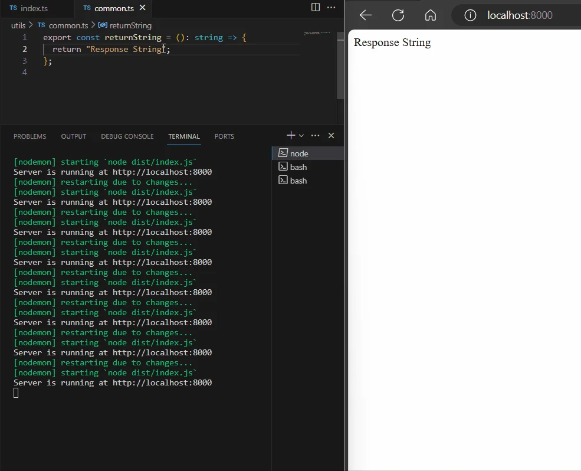

# Using Nodemon in TypeScript Project

## Automatic restart of local server in TypeScript Project

Folder Structure and file contents are given below.

```xml
- node_modules
- utils
  - common.ts
- index.ts
- nodemon.json
- package-lock.json
- package.json
- tsconfig.json
```

**tsconfig.json**

```json
{
  "compilerOptions": {
    "target": "es2016",                                 
    "lib": ["es2020", "dom"],
    "module": "commonjs",                               
    "outDir": "./dist",
    "esModuleInterop": true,                             
    "forceConsistentCasingInFileNames": true,           
    "strict": true,                                      
    "skipLibCheck": true                                 
  },
  "exclude": [
    "node_modules"
  ]
}
```

**package.json**

```json
{
  "name": "ts-node-mon",
  "version": "1.0.0",
  "description": "",
  "main": "index.js",
  "scripts": {
    "watch" : "tsc --watch",
    "start": "node dist/index.js",
    "dev": "nodemon"
  },
  "keywords": [],
  "author": "",
  "license": "ISC",
  "dependencies": {
    "express": "^4.19.1"
  },
  "devDependencies": {
    "typescript": "^5.4.3",
    "@types/express": "^4.17.21",
    "nodemon": "^3.1.0"
  }
}
```

**nodemon.json**

```json
{
  "watch": ["**/*.ts"],
  "ext": "ts",
  "exec": "node dist/index.js"
}
```

**index.ts**

```typescript
import express, { Express, Request, Response } from "express";
import { returnString } from "./utils/common";

const app: Express = express();

app.get("/", (req: Request, res: Response) => {
  const result = returnString();
  res.send(result);
});

app.listen(8000, () => {
    console.log(`Server is running at http://localhost:8000`);
});
```

**utils/common.ts**

```typescript
export const returnString = (): string => {
  return "Response String";
};
```

After setting up the project folder and installing node modules, Run the following commands one by one.

1.  `tsc` (All `.js` files will be created in `dist` folder as given in the `tsconfig.json` file)
    
2.  Open one terminal and run the command `npm run watch`
    
3.  Open another terminal and run the command `npm run dev`
    

With these steps, a development environment is established where modifications to TypeScript files trigger automatic transpilation to JavaScript, and the server reflects these changes in its responses.

Github code: [https://github.com/Krius2023/nodemon-in-typescript](https://github.com/Krius2023/nodemon-in-typescript)


