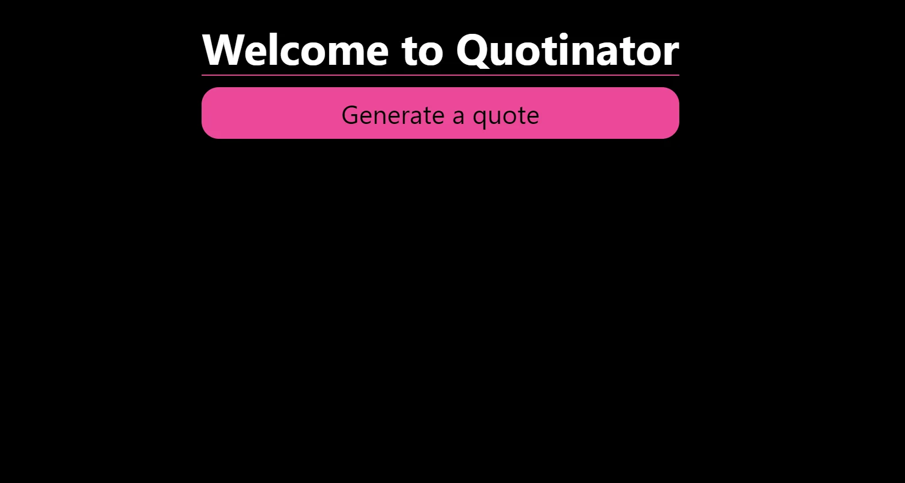
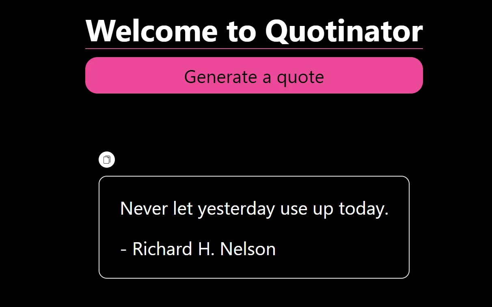

# Quote Generator using Vite-React & tailwind CSS

*   Set up vite-react. For reference: [https://vitejs.dev/guide/](https://vitejs.dev/guide/) (make sure you have installed the `node-modules`)
    
*   Set up tailwind CSS inside the vite-react project. For reference: [https://tailwindcss.com/docs/guides/vite](https://tailwindcss.com/docs/guides/vite) (make sure you added the tailwind directives in `index.css` file & necessary information in `tailwind.config.js` file)
    
*   The file structure is as follows:
    


1.  Place `favicon` file inside `public` folder
    
2.  Place a copy button image inside `/src/images` folder
    
3.  App.jsx file
    

```javascript
import { useState } from "react";
import { getTodaysQuote } from '../utils/get.quote';
import copyBtn from './images/copyBtn.png';

function App() {

  const [quote, setQuote] = useState("");
  const [by, setBy] = useState("");
  const [hasCopied, setHasCopied] = useState(false);

  const populateQuote = () => {
    setHasCopied(false)
    let quotesResponse = getTodaysQuote();
    setQuote(quotesResponse.body);
    setBy(quotesResponse.by);
  };
  const copyQuoteToClipboard = () => {
    setHasCopied(true)
    setTimeout(() => {setHasCopied(false)}, 750)
    navigator.clipboard.writeText(`${quote} - ${by}`);
  };

  return (
    <>
      <div className="w-max-[1000px] h-screen mt-200 px-10 flex flex-col justify-between items-center bg-black">

        <div className="md:p-0 px-10 fixed top-10 flex flex-col">
          <h1 className="py-2 border-b-2 border-pink-500 text-white text-center font-bold md:text-6xl text-xl">Welcome to Quotinator</h1>
          <button className="md:w-full md:p-4 p-1 my-4 rounded-3xl hover:bg-white bg-pink-500 text-black-500 md:text-4xl text-xl" onClick={populateQuote}>Generate a quote</button>
        </div>
        {quote ?
          <div className="my-52 md:my-80">
            <button onClick={copyQuoteToClipboard} className="bg-white px-2 py-2 mb-4 rounded-full right-0 top-0 self-end"></button>
            {hasCopied ? <button onClick={copyQuoteToClipboard} className="pl-2 text-white font-bold text-xl animate-bounce">✓</button> : ""}
            <h4 className="max-w-[800px] p-10 border-2 rounded-2xl text-white md:text-4xl text-xl">{quote}<br /><br />- {by}</h4>
          </div> : ""
        }
      </div>
    </>
  );
}

export default App;
```

1.  index.css
    

```css
@tailwind base;
@tailwind components;
@tailwind utilities;
```

1.  main.jsx
    

```javascript
import React from 'react';
import ReactDOM from 'react-dom/client';
import App from './App.jsx';
import './index.css';

ReactDOM.createRoot(document.getElementById('root')).render(
  <React.StrictMode>
    <App />
  </React.StrictMode>,
);
```

1.  get.quote.js
    

```javascript
import quotes from './quotes.json';

export const getTodaysQuote = () => {
    const number = Math.floor(Math.random() * quotes.length);
    return quotes[number];
};
```

1.  quotes.json
    

```javascript
[
    {
      "id": "0",
      "category": "Albert Einstein",
      "body": "Life is like riding a bicycle. To keep your balance you must keep moving.",
      "by": "Albert Einstein"
    },
    {
      "id": "1",
      "category": "Albert Einstein",
      "body": "The important thing is not to stop questioning. Curiosity has its own reason for existing.",
      "by": "Albert Einstein"
    },
    {
      "id": "2",
      "category": "Albert Einstein",
      "body": "No problem can be solved from the same level of consciousness that created it.",
      "by": "Albert Einstein"
    },.....] // can add multiple quote objects inside this array
```

1.  index.html
    

```xml
<!doctype html>
<html lang="en">

<head>
  <meta charset="UTF-8" />
  <link rel="icon" type="image/svg+xml" href="./public/q-icon.png" />
  <meta name="viewport" content="width=device-width, initial-scale=1.0" />
  <title>Quotinator</title>
</head>

<body style="background-color: black;">
  <div id="root"></div>
  <script type="module" src="./src/main.jsx"></script>
</body>

</html>
```

Start the app using `npm run dev` command.

App runs at `http://localhost:5173/`


