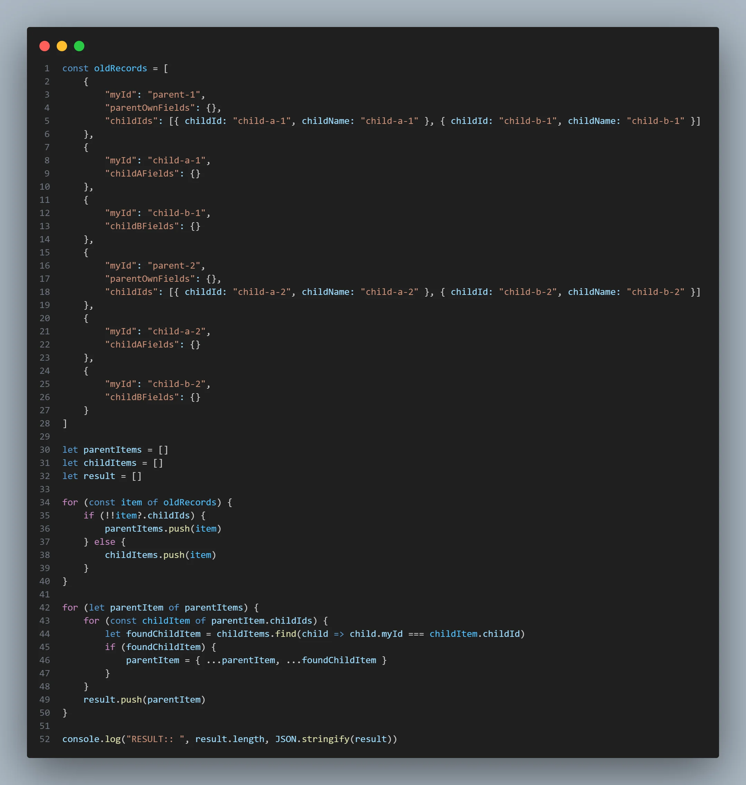

# I did this to complete one of my daily tasks - JavaScript - Array of objects

Sharing one from my day-to-day tasks along with the approach I used to complete it.

I am given a file with an array of old records. The array is structured as follows:

Let us call it - **input.json**

```json
[
  {
    "myId": "parent-1",
    "parentOwnFields": {},
    "childIds": [
      {
        "childId": "child-a-1",
        "childName": "child-a-1"
      },
      {
        "childId": "child-b-1",
        "childName": "child-b-1"
      }
    ]
  },
  {
    "myId": "child-a-1",
    "childAFields": {}
  },
  {
    "myId": "child-b-1",
    "childBFields": {}
  },
  {
    "myId": "parent-2",
    "parentOwnFields": {},
    "childIds": [
      {
        "childId": "child-a-2",
        "childName": "child-a-2"
      },
      {
        "childId": "child-b-2",
        "childName": "child-b-2"
      }
    ]
  },
  {
    "myId": "child-a-2",
    "childAFields": {}
  },
  {
    "myId": "child-b-2",
    "childBFields": {}
  }
]
```

**Task**:

Using **input.json,** I have to build another array of objects that follows the below structure: **(basically to combine parent item with its child items)**

```json
[
  {
    "myId": "child-b-1",
    "parentOwnFields": {},
    "childIds": [
      {
        "childId": "child-a-1",
        "childName": "child-a-1"
      },
      {
        "childId": "child-b-1",
        "childName": "child-b-1"
      }
    ],
    "childAFields": {},
    "childBFields": {}
  },
  {
    "myId": "child-b-2",
    "parentOwnFields": {},
    "childIds": [
      {
        "childId": "child-a-2",
        "childName": "child-a-2"
      },
      {
        "childId": "child-b-2",
        "childName": "child-b-2"
      }
    ],
    "childAFields": {},
    "childBFields": {}
  }
]
```

**My Approach:**

*   Declared & initialized 3 empty arrays - `parentItems`, `childItems`,`result`
    

```json
let parentItems = []
let childItems = []
let result = []
```

*   Getting all parent items in `parentItems` array.
    
*   Getting all child items in `childItems` array.
    

```javascript
for (const item of oldRecords) {
    if (!!item?.childIds) {
        parentItems.push(item)
    } else {
        childItems.push(item)
    }
}
```

In iteration, to identify if `item` is parent or not, I used `childIds` (like a flag).

If `item` has `childIds` field, it is a parent item otherwise child item.

*   Looping over `parentItems` array.
    
*   For each parentItem, again looping over its `childIds`, to collect its 2 child items from `childItems` array using array's `find` method.
    

```javascript
for (let parentItem of parentItems) {
    for (const childItem of parentItem.childIds) {
        let foundChildItem = childItems.find(child => child.myId === childItem.childId)
        if (foundChildItem) {
            parentItem = { ...parentItem, ...foundChildItem }
        }
    }
    result.push(parentItem)
}
```

*   Merging a parent item with its 2 child items. Pushing it to `result` array.
    




If I could have done it with a different approach, your points are welcome in the comments.

* * *

Thank you for reading my write-up. 📝💻

* * *
